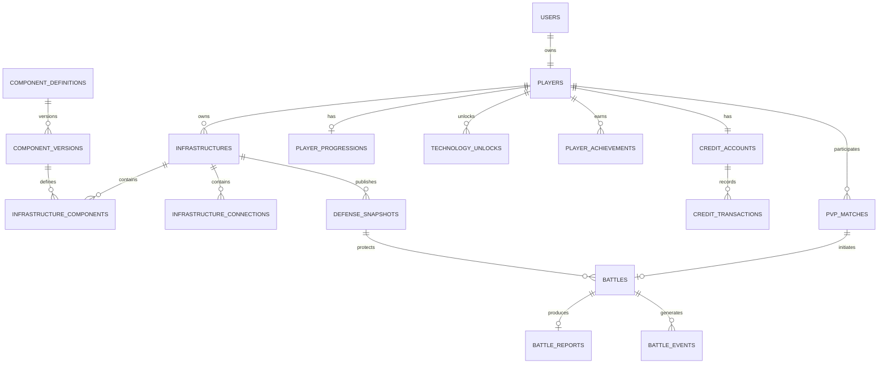

# Database Architecture

**Project:** CYBERFRONT  
**Document ID:** CF-ARCH-005  
**Version:** 0.1.0  
**Status:** Proposed  
**Phase:** Phase 0  
**Task:** 02.5 - Database Architecture  
**Date:** November 25, 2026

**Related Documents:**

- `docs/product/product-foundation.md`
- `docs/architecture/system-overview.md`
- `docs/architecture/service-boundaries.md`
- `docs/architecture/frontend-architecture.md`
- `docs/architecture/backend-architecture.md`

---

## 1. Purpose

Dokumen ini mendefinisikan arsitektur database CYBERFRONT menggunakan PostgreSQL sebagai primary persistent database.

Database harus mendukung:

- Player accounts dan profiles.
- Infrastructure workspace.
- Installed components.
- Network topology.
- Component configurations.
- Component catalog dan versioning.
- Resource allocation.
- Credit economy dan transaction ledger.
- Player progression.
- PvP matchmaking.
- Immutable Defense Snapshots.
- Battle lifecycle.
- Battle Reports.
- Simulation events dan replay.
- Auditability dan data integrity.

Dokumen ini menetapkan strategi penyimpanan, data ownership, relasi entitas, indexing, constraints, migration, dan integritas data.

Implementasi database aktual dilakukan pada fase development berikutnya.

## 2. Database Technology

### 2.1 Primary Database

**PostgreSQL** ditetapkan sebagai primary persistent database.

Alasan pemilihan:

- Relational integrity.
- ACID transactions.
- Foreign key constraints.
- JSONB untuk structured configuration.
- Indexing yang fleksibel.
- Transactional consistency.
- Dukungan untuk data relasional dan semi-structured.
- Mature migration dan backup ecosystem.

### 2.2 Supporting Infrastructure

| Component         | Responsibility                                              |
| ----------------- | ----------------------------------------------------------- |
| PostgreSQL        | Primary persistent storage                                  |
| Redis             | Cache, queue, temporary coordination                        |
| Laravel Queue     | Background processing                                       |
| Simulation Engine | Runtime simulation state                                    |
| Object Storage    | Optional storage untuk replay atau artifact berukuran besar |

Redis bukan sumber kebenaran untuk saldo, ownership, battle results, atau data persistent lainnya.

### 2.3 Database Architecture Strategy

Pada MVP:

- Satu PostgreSQL database.
- Satu logical database schema strategy.
- Ownership tabel dipisahkan berdasarkan modul.
- Foreign key digunakan untuk relasi penting.
- Modul tidak boleh menulis tabel milik modul lain.
- Tidak ada database terpisah untuk setiap modul.

Pemisahan database per service hanya dipertimbangkan apabila kebutuhan scaling atau deployment benar-benar membenarkannya.

## 3. Database Design Principles

Prinsip desain database:

1. Data Ownership: setiap tabel memiliki satu modul pemilik.
2. Referential Integrity: relasi penting dijaga dengan foreign key.
3. Transaction Integrity: operasi penting harus konsisten secara atomik.
4. Immutable Records: data historis yang menjadi bukti harus tidak dapat diubah sembarangan.
5. Explicit Versioning: data yang digunakan simulasi harus memiliki versi.
6. Idempotency: operasi berulang tidak boleh menggandakan efek bisnis.
7. Query Efficiency: indexing berdasarkan pola query aktual.
8. Auditability: perubahan penting dapat ditelusuri.
9. Controlled Denormalization: denormalisasi dilakukan jika ada kebutuhan performa atau snapshot.
10. Data Isolation: pemain hanya dapat mengakses resource yang menjadi haknya.

## 4. Database Ownership

Database dibagi berdasarkan delapan modul backend.

| Module            | Data Ownership                                                    |
| ----------------- | ----------------------------------------------------------------- |
| Identity & Access | User identity, credentials, access tokens                         |
| Players           | Player profile, preferences, statistics                           |
| Infrastructure    | Infrastructure, installed components, connections, configurations |
| Component Catalog | Component definitions, specifications, versions                   |
| Economy           | Credit accounts, transactions, ledger                             |
| Progression       | Experience, research, unlocks, achievements                       |
| PvP               | Matchmaking records, match requests                               |
| Battles           | Battle records, snapshots references, reports, replay metadata    |

### 4.1 Ownership Rules

- Setiap tabel hanya boleh ditulis oleh modul pemiliknya.
- Modul lain mengakses data melalui public application interface.
- Cross-module database writes dilarang.
- Foreign key antar modul boleh digunakan untuk menjaga referential integrity.
- Foreign key tidak memberikan izin kepada modul lain untuk mengubah data pemiliknya.
- Shared tables harus dihindari.
- Data yang membutuhkan koordinasi antarmodul menggunakan application interface atau domain events.

Contoh:

Economy Module memiliki tabel `credit_accounts` dan `credit_transactions`.

Infrastructure Module boleh meminta Economy memproses pembelian, tetapi tidak boleh menjalankan:

```sql
UPDATE credit_accounts
SET balance = balance - 100;
```

Operasi tersebut hanya boleh dilakukan oleh Economy Module.

## 5. Naming Conventions

### 5.1 Table Naming

Gunakan:

- Lowercase.
- Snake case.
- Plural nouns.
- Nama yang menggambarkan entitas.

Contoh:

```text
users
players
infrastructures
infrastructure_components
infrastructure_connections
component_definitions
component_versions
credit_accounts
credit_transactions
battles
battle_reports
```

### 5.2 Column Naming

Gunakan snake_case.

Contoh:

```text
created_at
updated_at
player_id
infrastructure_id
component_version_id
snapshot_hash
ruleset_version
```

### 5.3 Primary Keys

Gunakan UUID untuk primary key entitas utama.

Contoh:

```text
id UUID PRIMARY KEY
```

Alasan:

- Tidak mengekspos sequential IDs secara langsung.
- Memudahkan identifikasi lintas sistem.
- Mendukung distributed processing di masa depan.
- Cocok untuk referensi antarsistem.

UUID bukan mekanisme authorization. Ownership tetap harus diperiksa oleh backend.

Untuk tabel internal berukuran besar, penggunaan BIGINT sebagai primary key dapat dipertimbangkan jika terbukti memberikan keuntungan performa. Namun, keputusan harus konsisten per jenis tabel dan tidak mengorbankan kontrak identitas publik.

### 5.4 Timestamp

Gunakan timestamp yang menyimpan timezone:

```text
TIMESTAMPTZ
```

Standar penyimpanan waktu menggunakan UTC.

Contoh kolom:

```text
created_at
updated_at
published_at
completed_at
```

### 5.5 Soft Deletes

Soft delete digunakan hanya untuk entitas yang memang membutuhkan pemulihan atau penghapusan logis.

Contoh:

- Player profile.
- Infrastructure draft.

Hindari soft delete untuk:

- Credit ledger.
- Battle reports.
- Published Defense Snapshots.
- Audit records.

Data historis penting tidak boleh hilang hanya karena sebuah entitas dihapus dari tampilan pengguna.

## 6. Core Entity Architecture

Bagian ini mendefinisikan entitas utama dan relasinya secara konseptual.

### 6.1 Identity & Players

Entitas:

**users**

- id
- email
- password
- email_verified_at
- status
- created_at
- updated_at

**players**

- id
- user_id
- username
- display_name
- created_at
- updated_at

**player_settings**

- id
- player_id
- settings
- created_at
- updated_at

Relasi:

```text
users
  |
  | 1:1
  v
players
  |
  | 1:1
  v
player_settings
```

Ketentuan:

- Satu user memiliki satu player profile pada MVP.
- Username harus unique.
- Email harus unique.
- Penghapusan user harus mempertimbangkan referensi historis dan audit.

### 6.2 Infrastructure

Entitas:

**infrastructures**

- id
- player_id
- name
- description
- status
- created_at
- updated_at

**infrastructure_components**

- id
- infrastructure_id
- component_definition_id
- component_version_id
- instance_name
- position_x
- position_y
- configuration
- resource_allocation
- status
- created_at
- updated_at

**infrastructure_connections**

- id
- infrastructure_id
- source_component_id
- target_component_id
- connection_type
- configuration
- created_at
- updated_at

Relasi:

```text
players
  |
  | 1:N
  v
infrastructures
  |
  | 1:N
  v
infrastructure_components
  |
  | N:M through connections
  v
infrastructure_connections
```

Ketentuan:

- Satu player dapat memiliki beberapa infrastructure.
- Satu infrastructure memiliki banyak component instances.
- Satu component instance dapat memiliki banyak koneksi.
- Komponen harus menjadi bagian dari infrastructure yang sama ketika dihubungkan.
- Posisi visual komponen tidak menentukan konektivitas jaringan.
- `position_x` dan `position_y` adalah metadata workspace, bukan sumber kebenaran network topology.
- Konfigurasi harus divalidasi terhadap component schema yang sesuai.

### 6.3 Component Catalog

Entitas:

**component_definitions**

- id
- code
- name
- category
- description
- status
- created_at
- updated_at

**component_versions**

- id
- component_definition_id
- version
- specification
- configuration_schema
- resource_requirements
- compatibility_rules
- created_at

Relasi:

```text
component_definitions
  |
  | 1:N
  v
component_versions
```

Ketentuan:

- Component definition merepresentasikan jenis komponen.
- Component version merepresentasikan spesifikasi tertentu.
- Versi yang telah digunakan oleh snapshot tidak boleh diubah secara destruktif.
- Perubahan spesifikasi yang memengaruhi simulasi harus menghasilkan versi baru.
- Instance komponen harus memiliki referensi ke versi yang digunakan.

### 6.4 Economy

Entitas:

**credit_accounts**

- id
- player_id
- balance
- currency_code
- created_at
- updated_at

**credit_transactions**

- id
- account_id
- transaction_type
- amount
- balance_after
- reference_type
- reference_id
- idempotency_key
- metadata
- created_at

Relasi:

```text
players
  |
  | 1:1
  v
credit_accounts
  |
  | 1:N
  v
credit_transactions
```

Ketentuan:

- Balance tidak boleh negatif kecuali aturan ekonomi secara eksplisit mengizinkannya.
- Transaction amount menggunakan numeric atau BIGINT sesuai keputusan unit mata uang.
- Gunakan satuan integer terkecil untuk menghindari floating-point precision errors.
- Transaction record bersifat append-only.
- Koreksi transaksi dilakukan menggunakan compensating transaction.
- Setiap operasi ekonomi memiliki idempotency key.
- Saldo akun dan ledger harus diperbarui dalam satu database transaction.
- Setiap transaksi harus dapat ditelusuri ke sumber aktivitasnya.

`balance_after` dapat digunakan sebagai historical balance checkpoint dan harus konsisten dengan transaksi yang bersangkutan.

### 6.5 Progression

Entitas:

**player_progressions**

- id
- player_id
- experience_points
- level
- created_at
- updated_at

**technology_unlocks**

- id
- player_id
- technology_code
- unlocked_at

**player_achievements**

- id
- player_id
- achievement_code
- completed_at
- metadata

Relasi:

```text
players
  |
  +---- player_progressions
  |
  +---- technology_unlocks
  |
  +---- player_achievements
```

Ketentuan:

- Setiap player memiliki progression record.
- Unlock harus mengikuti progression requirements.
- Reward Credits diproses melalui Economy Module.
- Unlock dan reward harus idempotent.

### 6.6 PvP

Entitas:

**pvp_matches**

- id
- attacker_player_id
- defender_player_id
- battle_id
- status
- created_at
- updated_at

**matchmaking_records**

- id
- player_id
- matchmaking_status
- criteria
- created_at
- updated_at

Relasi:

```text
players
  |
  +---- attacker_player_id
  |
  +---- defender_player_id
         |
         v
     pvp_matches
         |
         v
      battles
```

Ketentuan:

- PvP Module memiliki matchmaking records dan match state.
- Battles Module memiliki battle lifecycle.
- PvP Module hanya menyimpan referensi battle ID.
- Pemrosesan battle tidak dilakukan oleh PvP Module.

### 6.7 Battles

Entitas:

**battles**

- id
- attacker_player_id
- defender_player_id
- defense_snapshot_id
- simulation_status
- ruleset_version
- simulation_seed
- created_at
- started_at
- completed_at

**defense_snapshots**

- id
- infrastructure_id
- player_id
- snapshot_version
- schema_version
- component_catalog_version
- ruleset_version
- snapshot_data
- snapshot_hash
- published_at

**battle_reports**

- id
- battle_id
- result_status
- result_data
- summary
- created_at

**battle_events**

- id
- battle_id
- sequence_number
- event_type
- event_data
- created_at

Relasi:

```text
infrastructures
      |
      v
defense_snapshots
      |
      v
    battles
      |
      +---- battle_reports
      |
      +---- battle_events
```

Ketentuan:

- Battle menggunakan satu Defense Snapshot yang immutable.
- Battle Report terhubung ke satu battle.
- Battle Events memiliki urutan sequence yang eksplisit.
- Simulation seed dan ruleset version harus tersimpan.
- Replay harus dapat ditelusuri ke event sequence yang dihasilkan Engine.
- Hasil simulasi yang telah divalidasi tidak boleh diubah tanpa audit trail.

## 7. Entity Relationship Overview

Gambaran relasi inti:



ERD ini merupakan logical model awal. Cardinality dan beberapa relasi dapat disesuaikan ketika desain detail modul dilakukan.

## 8. Defense Snapshot Architecture

Defense Snapshot merupakan salah satu entitas paling penting dalam CYBERFRONT.

Snapshot merepresentasikan kondisi pertahanan infrastructure pada saat dipublikasikan.

Snapshot harus immutable agar battle yang sudah dibuat tetap dapat direproduksi.

### 8.1 Snapshot Data

Snapshot minimal menyimpan:

- Infrastructure identity.
- Player identity.
- Component instances.
- Component versions.
- Component configurations.
- Network connections.
- Resource allocations.
- Catalog version.
- Snapshot schema version.
- Simulation ruleset version.
- Snapshot creation metadata.

### 8.2 Snapshot Storage

Pada MVP, snapshot dapat disimpan sebagai JSONB di PostgreSQL.

Contoh struktur konseptual:

```json
{
  "snapshot_id": "uuid",
  "schema_version": "1.0.0",
  "catalog_version": "1.0.0",
  "ruleset_version": "1.0.0",
  "infrastructure": {
    "id": "uuid",
    "components": [],
    "connections": []
  },
  "resource_allocations": {},
  "metadata": {
    "published_at": "2026-11-25T00:00:00Z"
  }
}
```

Contoh di atas hanya menunjukkan bentuk data, bukan kontrak final Simulation Engine.

### 8.3 Snapshot Hash

Setiap snapshot harus memiliki hash untuk mendeteksi perubahan data.

Ketentuan:

- Gunakan canonical serialization sebelum hashing.
- Tetapkan algoritma hashing yang eksplisit.
- Gunakan SHA-256 sebagai pilihan awal.
- Hash dihitung dari payload canonical, bukan dari representasi JSON mentah yang urutan key-nya dapat berbeda.
- Simpan hash bersama snapshot.
- Engine dapat memverifikasi hash sebelum menjalankan simulasi.

### 8.4 Snapshot Immutability

Setelah snapshot dipublikasikan:

- Payload tidak boleh diperbarui.
- Snapshot tidak boleh digunakan ulang untuk merepresentasikan state baru.
- Perubahan infrastructure menghasilkan snapshot baru.
- Snapshot lama tetap tersedia selama masih diperlukan oleh battle atau audit.
- Penghapusan mengikuti retention policy dan integritas referensi historis.

### 8.5 Snapshot Versioning

Snapshot harus memiliki beberapa versi berbeda:

| Version                   | Purpose                   |
| ------------------------- | ------------------------- |
| schema_version            | Struktur format snapshot  |
| component_catalog_version | Definisi komponen         |
| ruleset_version           | Aturan simulasi           |
| snapshot_version          | Identitas revisi snapshot |

Keempat versi ini memiliki tanggung jawab berbeda dan tidak boleh digabung menjadi satu nomor versi.

## 9. Database Constraints

Constraints harus digunakan untuk melindungi integritas data.

### 9.1 Primary Key

Setiap tabel entitas memiliki primary key.

### 9.2 Foreign Key

Foreign key digunakan untuk:

- Player ownership.
- Infrastructure ownership.
- Component references.
- Snapshot references.
- Battle references.
- Ledger account references.

### 9.3 Unique Constraints

Contoh:

```text
users.email
players.username
component_definitions.code
component_versions(component_definition_id, version)
credit_accounts.player_id
technology_unlocks(player_id, technology_code)
```

Tambahkan unique constraint untuk idempotency key sesuai scope operasi.

### 9.4 Check Constraints

Contoh:

```text
credit_accounts.balance >= 0
credit_transactions.amount > 0
infrastructure_components.position_x >= 0
infrastructure_components.position_y >= 0
```

Aturan nilai negatif pada transaction amount dapat menggunakan `transaction_type` dan konvensi tanda yang konsisten. Alternatifnya, simpan amount positif dan tentukan arah transaksi melalui tipe debit atau credit.

Keputusan final harus konsisten di seluruh Economy Module.

### 9.5 Referential Actions

Gunakan `RESTRICT` atau strategi penghapusan terkontrol untuk data historis penting.

Hindari `CASCADE DELETE` pada:

- Credit transactions.
- Published snapshots.
- Battle reports.
- Battle events.
- Audit records.

Penghapusan parent tidak boleh menghancurkan bukti historis.

## 10. Indexing Strategy

Index dibuat berdasarkan pola query, bukan sekadar setiap kolom diberi index.

Index awal yang dipertimbangkan:

| Table                      | Candidate Index                                                       |
| -------------------------- | --------------------------------------------------------------------- |
| users                      | unique(email)                                                         |
| players                    | unique(username), user_id                                             |
| infrastructures            | player_id, created_at                                                 |
| infrastructure_components  | infrastructure_id, component_definition_id                            |
| infrastructure_connections | infrastructure_id, source_component_id, target_component_id           |
| component_definitions      | unique(code), category                                                |
| component_versions         | unique(component_definition_id, version)                              |
| credit_accounts            | unique(player_id)                                                     |
| credit_transactions        | account_id, created_at                                                |
| technology_unlocks         | unique(player_id, technology_code)                                    |
| pvp_matches                | attacker_player_id, defender_player_id, status                        |
| battles                    | attacker_player_id, defender_player_id, simulation_status, created_at |
| defense_snapshots          | infrastructure_id, published_at, snapshot_hash                        |
| battle_reports             | unique(battle_id)                                                     |
| battle_events              | unique(battle_id, sequence_number)                                    |

Ketentuan:

- Hindari redundant indexes.
- Gunakan composite indexes sesuai query pattern.
- Gunakan partial indexes apabila query dan distribusi data mendukungnya.
- JSONB indexes hanya ditambahkan jika query JSONB benar-benar diperlukan.
- Evaluasi query menggunakan EXPLAIN ANALYZE.
- Monitor index size dan write overhead.

## 11. JSONB Usage Strategy

JSONB digunakan untuk data semi-structured yang memang membutuhkan fleksibilitas.

Penggunaan yang disarankan:

- Component configuration.
- Component specifications.
- Resource allocation metadata.
- Snapshot payload.
- Battle result metadata.
- Battle event payload.
- Player settings.

JSONB tidak digunakan sebagai pengganti seluruh relational schema.

Data yang membutuhkan:

- Foreign key.
- Unique constraints.
- Frequent filtering.
- Transactional updates.
- Strong relational integrity.

Sebaiknya tetap menggunakan kolom relational.

Setiap JSONB yang digunakan untuk konfigurasi atau simulasi harus memiliki schema validation dan versioning.

## 12. Credit Ledger Integrity

Economy merupakan domain dengan kebutuhan konsistensi tinggi.

### 12.1 Ledger Rules

- Credit transaction bersifat append-only.
- Balance account dan transaction ledger harus konsisten.
- Setiap transaksi memiliki reference yang dapat ditelusuri.
- Setiap transaksi memiliki idempotency protection.
- Saldo tidak boleh berubah tanpa transaksi ledger.
- Koreksi menggunakan compensating transaction.
- Operasi balance update menggunakan row-level locking atau mekanisme concurrency control yang sesuai.

### 12.2 Purchase Workflow

```text
Purchase Request
      |
      v
Validate Player
      |
      v
Validate Component
      |
      v
Begin Transaction
      |
      v
Lock Credit Account
      |
      v
Check Balance
      |
      v
Deduct Credits
      |
      v
Insert Ledger Transaction
      |
      v
Commit Transaction
      |
      v
Complete Purchase
```

Jika salah satu langkah gagal sebelum commit, seluruh perubahan database harus di-rollback.

Untuk workflow yang melibatkan modul lain, gunakan application interface dan pola koordinasi yang menjaga konsistensi.

### 12.3 Reconciliation

Sistem harus dapat memeriksa apakah:

- Balance sesuai dengan riwayat ledger.
- Tidak ada duplicate transaction.
- Tidak ada transaksi tanpa reference yang valid.
- Tidak ada saldo yang berubah tanpa audit trail.

Reconciliation dapat dijalankan secara periodik.

## 13. Battle Data Integrity

Battle merupakan workflow yang memiliki nilai historis dan teknis.

Data minimum yang harus dipertahankan:

- Battle ID.
- Attacker dan defender.
- Defense Snapshot ID.
- Snapshot hash.
- Simulation seed.
- Ruleset version.
- Simulation contract version.
- Execution status.
- Result metadata.
- Event sequence.
- Timestamps.

### 13.1 Battle Result Integrity

Hasil yang diterima dari Simulation Engine harus melalui validasi sebelum disimpan sebagai hasil final.

Validasi meliputi:

- Battle identity.
- Snapshot identity.
- Snapshot hash.
- Ruleset version.
- Contract version.
- Result structure.
- Event sequence integrity.
- Duplicate submission detection.

### 13.2 Replay Integrity

Replay harus menggunakan data event yang dihasilkan dari simulasi yang telah selesai.

Event sequence harus:

- Memiliki nomor urut.
- Tidak memiliki duplikasi.
- Dapat ditelusuri ke battle.
- Memiliki schema version.
- Tidak dapat diubah sembarangan setelah battle selesai.

Jika ukuran replay membesar, event payload dapat dipindahkan ke object storage dengan metadata dan hash tetap disimpan di PostgreSQL.

## 14. Migration Strategy

Database schema dikelola melalui Laravel migrations.

Aturan:

- Setiap perubahan schema harus memiliki migration.
- Migration harus dapat direview.
- Migration tidak boleh dilakukan secara manual di production tanpa proses terkontrol.
- Migration harus diuji pada environment testing.
- Perubahan destructive harus memiliki backup dan rollback plan.
- Hindari menggabungkan perubahan schema besar tanpa kebutuhan.

### 14.1 Migration Naming

Contoh:

```text
202611250001_create_players_table
202611250002_create_infrastructures_table
202611250003_create_component_definitions_table
202611250004_create_credit_accounts_table
202611250005_create_battles_table
```

### 14.2 Expand and Contract

Untuk perubahan schema yang berisiko:

1. Tambahkan struktur baru.
2. Deploy kode yang kompatibel dengan struktur lama dan baru.
3. Migrasikan data jika diperlukan.
4. Pindahkan pembacaan dan penulisan.
5. Hapus struktur lama setelah aman.

Strategi ini mengurangi risiko downtime dan incompatibility.

## 15. Backup and Recovery

Database harus memiliki strategi backup.

Minimum requirements:

- Scheduled database backups.
- Point-in-time recovery jika infrastruktur mendukung.
- Backup encryption.
- Backup retention policy.
- Recovery testing.
- Backup access control.
- Monitoring backup failures.

Backup yang belum pernah diuji restore-nya hanya memberi rasa aman palsu.

Target RPO dan RTO akan ditentukan setelah kebutuhan operasional dan infrastruktur deployment diketahui.

## 16. Data Retention and Lifecycle

Setiap kategori data memiliki lifecycle berbeda.

| Data                  | Retention Principle                       |
| --------------------- | ----------------------------------------- |
| User accounts         | Berdasarkan account lifecycle             |
| Player profiles       | Selama akun aktif atau sesuai kebijakan   |
| Infrastructure drafts | Dapat dihapus sesuai kebijakan            |
| Published snapshots   | Dipertahankan selama masih direferensikan |
| Credit ledger         | Dipertahankan sebagai financial history   |
| Battle reports        | Dipertahankan sebagai battle history      |
| Battle events         | Sesuai kebutuhan replay dan audit         |
| Logs                  | Mengikuti operational retention policy    |
| Temporary queue data  | Mengikuti lifecycle job                   |

Data yang direferensikan oleh battle historis tidak boleh dihapus tanpa mekanisme archival yang menjaga kemampuan audit dan replay.

## 17. Security and Privacy

Database security requirements:

- Database tidak boleh diekspos langsung ke public internet.
- Gunakan least-privilege database credentials.
- Pisahkan credentials antar environment.
- Enkripsi koneksi database.
- Lindungi backup.
- Batasi akses administratif.
- Jangan menyimpan plaintext password.
- Gunakan Laravel password hashing.
- Hindari menyimpan secret dalam JSONB configuration.
- Terapkan audit untuk operasi sensitif.
- Gunakan parameterized queries.
- Batasi akses data berdasarkan player ownership.

Sensitive data tidak boleh ikut terekspos dalam API Resource atau log.

## 18. Performance Considerations

Strategi awal:

- Gunakan pagination untuk daftar data.
- Gunakan eager loading untuk relasi yang dibutuhkan.
- Hindari N+1 queries.
- Gunakan indexes sesuai pola akses.
- Hindari query JSONB yang tidak diperlukan.
- Pisahkan pekerjaan berat ke background queue.
- Gunakan database connection pooling jika dibutuhkan.
- Monitor slow queries.
- Evaluasi partitioning hanya jika volume data benar-benar membutuhkannya.

Battle events dan ledger berpotensi tumbuh besar. Desain awal harus mempertimbangkan growth tanpa langsung menerapkan optimasi prematur.

## 19. Architectural Constraints

Aturan wajib:

1. PostgreSQL adalah primary persistent database.
2. Redis bukan authoritative data store.
3. Setiap modul memiliki tabel yang menjadi ownership-nya.
4. Cross-module writes dilarang.
5. Economy memiliki seluruh Credit Ledger.
6. Credit transactions bersifat append-only.
7. Published Defense Snapshots bersifat immutable.
8. Battle harus menyimpan referensi snapshot, seed, dan ruleset.
9. Replay harus dapat ditelusuri ke event sequence.
10. Relational data menggunakan foreign keys dan constraints.
11. JSONB digunakan secara selektif dengan schema validation.
12. Database migrations harus melalui version control.
13. Data historis tidak boleh terhapus akibat cascade yang tidak terkontrol.
14. Operasi penting harus mendukung idempotency dan auditability.

## 20. Architecture Decision Record

### ADR-005: PostgreSQL Database Architecture

**Status:** Proposed

**Context**

CYBERFRONT membutuhkan persistent storage untuk data pemain, infrastructure, ekonomi, progression, snapshot, battle history, dan replay.

Data tersebut memiliki kebutuhan relational integrity, transactional consistency, serta penyimpanan structured dan semi-structured.

**Decision**

Menggunakan PostgreSQL sebagai primary database dengan satu database pada tahap awal dan strict logical data ownership berdasarkan modul.

JSONB digunakan secara selektif untuk konfigurasi, snapshot, dan event payload.

Defense Snapshot dan historical records harus memiliki mekanisme immutability dan versioning.

**Consequences**

Positive:

- Relational integrity.
- Strong transactional support.
- Flexible JSONB storage.
- Simpler MVP deployment.
- Clear data ownership.
- Historical battle reproducibility.

Trade-offs:

- Shared database membutuhkan disiplin module boundaries.
- JSONB memerlukan schema validation.
- Snapshot dan event storage dapat tumbuh besar.
- Migration dan data retention membutuhkan governance.

**Alternatives Considered**

- PostgreSQL.
- MySQL.
- Multiple databases per module.
- Document database as primary storage.

**Selected:** PostgreSQL single-database strategy for MVP.

## 21. Acceptance Criteria

Database Architecture dianggap selesai apabila:

- [ ] PostgreSQL ditetapkan sebagai primary database.
- [ ] Database ownership setiap modul didefinisikan.
- [ ] Naming conventions ditetapkan.
- [ ] Primary key dan timestamp strategy ditetapkan.
- [ ] Core entities dan relationships terdokumentasi.
- [ ] Logical ERD tersedia.
- [ ] Defense Snapshot storage dan immutability didefinisikan.
- [ ] Snapshot versioning dan hashing strategy ditetapkan.
- [ ] Credit ledger integrity rules ditetapkan.
- [ ] Battle data integrity rules ditetapkan.
- [ ] Database constraints dan indexing strategy ditetapkan.
- [ ] JSONB usage strategy ditetapkan.
- [ ] Migration strategy ditetapkan.
- [ ] Backup dan recovery requirements terdokumentasi.
- [ ] Data retention strategy ditetapkan.
- [ ] ADR-005 terdokumentasi.

## 22. Related Documents

- `docs/product/product-foundation.md`
- `docs/architecture/system-overview.md`
- `docs/architecture/service-boundaries.md`
- `docs/architecture/frontend-architecture.md`
- `docs/architecture/backend-architecture.md`
- `docs/architecture/database-architecture.md`

---

**End of Document**
