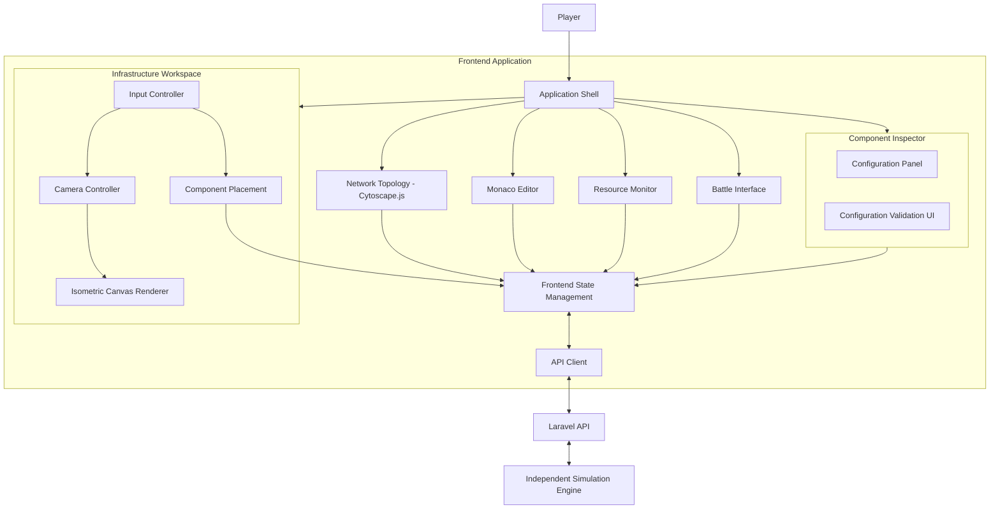

# CYBERFRONT

## Frontend Architecture

**Document ID:** CF-ARCH-003  
**Architecture Decision:** CF-ADR-003  
**Version:** 0.1.0  
**Phase:** 0 - Product Foundation  
**Task:** 02.3 - Frontend Architecture  
**Status:** Proposed  
**Date:** November 25, 2026

---

# 1. Introduction

## 1.1 Purpose

Dokumen ini mendefinisikan arsitektur frontend CYBERFRONT, termasuk teknologi, rendering architecture, UI modules, state management, user interactions, dan komunikasi dengan backend.

Frontend bertindak sebagai presentation layer sekaligus engineering workspace bagi pemain.

## 1.2 Design Goals

Frontend harus mendukung:

- Isometric infrastructure visualization.
- Free building interaction.
- Component management.
- Network topology visualization.
- Technical configuration.
- Resource monitoring.
- Battle interface.
- Battle replay.
- Responsive application layout.
- Clear separation between UI and simulation logic.

---

# 2. Technology Stack

| Technology    | Responsibility                           |
| ------------- | ---------------------------------------- |
| TypeScript    | Primary frontend programming language    |
| Alpine.js     | Reactive UI and lightweight interactions |
| HTML/CSS      | Application layout and presentation      |
| Canvas 2D     | Isometric workspace rendering            |
| Cytoscape.js  | Network topology visualization           |
| Monaco Editor | Technical configuration editor           |
| Vite          | Development server and asset bundling    |

## 2.1 Technology Philosophy

Frontend technology must remain modular.

Complex rendering and interaction logic should use TypeScript modules rather than being implemented entirely inside Alpine.js components.

Alpine.js is responsible for lightweight DOM interactions and UI state integration.

---

# 3. Frontend Architecture Overview

Frontend consists of the following logical areas:

1. Application Shell.
2. Infrastructure Workspace.
3. Component Inspector.
4. Network Topology.
5. Resource Monitor.
6. Configuration Editor.
7. Battle Interface.

## 3.1 Architecture Diagram



This represents logical component relationships, not a requirement that every UI area runs as an independent process.

---

# 4. Application Shell

## 4.1 Responsibility

Application Shell provides the common layout and navigation structure.

Responsibilities:

- Global navigation.
- Player information.
- Resource summary.
- Notification center.
- Workspace routing.
- Global UI state.
- Application-level error handling.

## 4.2 Main Navigation

Initial navigation areas:

- Dashboard.
- Infrastructure.
- Component Catalog.
- Network Topology.
- Monitoring.
- PvP.
- Battles.
- Progression.
- Settings.

---

# 5. Infrastructure Workspace

## 5.1 Responsibility

Infrastructure Workspace is the primary building environment.

It provides an interactive isometric representation of the player's infrastructure.

## 5.2 Rendering Technology

Initial renderer:

**HTML Canvas 2D**

Canvas 2D is selected for the initial MVP because it provides sufficient rendering capabilities for a controlled isometric workspace without introducing unnecessary graphics infrastructure.

The rendering architecture must remain replaceable if future performance requirements justify another rendering technology.

## 5.3 Workspace Features

- Isometric camera.
- Camera pan.
- Camera zoom.
- Component selection.
- Component placement.
- Component movement.
- Component deletion.
- Network connection visualization.
- Selection highlighting.
- Component status indicators.
- Resource overlays.
- Visual validation feedback.

## 5.4 Coordinate System

The workspace must separate:

- World coordinates.
- Screen coordinates.
- Component dimensions.
- Camera transformations.

Screen coordinates must never become the authoritative identity or connectivity model of infrastructure components.

The renderer is responsible for converting world coordinates into screen coordinates.

## 5.5 Free Building

The building system allows players to place components freely.

Placement must support:

- Valid placement.
- Invalid placement feedback.
- Component selection.
- Component movement.
- Placement previews.
- Resource availability indicators.

Physical visual placement and logical network connectivity must remain separate.

---

# 6. Component Inspector

## 6.1 Responsibility

Component Inspector displays and manages the selected component's configuration.

## 6.2 Component Information

The inspector may display:

- Component identity.
- Component category.
- Operational status.
- Resource allocation.
- Network interfaces.
- Dependencies.
- Configuration properties.
- Security properties.
- Runtime metrics.

## 6.3 Configuration Management

Configuration forms must be generated or validated using component configuration schemas.

Frontend must not independently define authoritative component configuration rules.

Configuration validation may provide immediate feedback, but backend and Simulation Engine remain responsible for authoritative validation.

---

# 7. Network Topology Visualization

## 7.1 Technology

Cytoscape.js.

## 7.2 Responsibility

Network Topology provides a logical graph representation of infrastructure.

It visualizes:

- Network nodes.
- Network edges.
- Component relationships.
- Logical connectivity.
- Service dependencies.
- Network paths.
- Selected components.
- Connection status.

## 7.3 Graph Model

The graph must represent logical relationships.

Example:

```text
Internet
   |
Router
   |
Firewall
   |
Reverse Proxy
   |
Application
   |
PostgreSQL
```

## 7.4 Separation from Isometric Renderer

The topology graph and isometric workspace are different visualization contexts.

Both must consume compatible infrastructure data but maintain separate rendering models.

Canvas component positions must not determine actual network connectivity.

---

# 8. Configuration Editor

## 8.1 Technology

Monaco Editor.

## 8.2 Responsibility

Monaco Editor provides advanced text editing capabilities for technical configuration.

Initial use cases:

- Firewall rules.
- Routing configuration.
- Application configuration.
- Linux configuration.
- Database configuration.
- Service configuration.

## 8.3 Editor Features

- Syntax highlighting.
- Configuration validation.
- Error highlighting.
- Basic autocomplete.
- Configuration formatting.
- Unsaved changes indicator.

Editor language definitions and validation rules must be introduced incrementally.

All configurations are treated as structured virtual configuration data.

They must not execute arbitrary commands against the host infrastructure.

---

# 9. Resource Monitor

## 9.1 Responsibility

Resource Monitor visualizes the technical condition of the player's infrastructure.

## 9.2 Initial Metrics

| Metric       | Description             |
| ------------ | ----------------------- |
| CPU          | Processing utilization  |
| RAM          | Memory utilization      |
| Storage      | Storage utilization     |
| Bandwidth    | Network utilization     |
| Latency      | Communication delay     |
| Availability | Service availability    |
| Connections  | Active connection count |

## 9.3 Data Source

Resource metrics originate from Simulation Engine observations.

Frontend is responsible only for displaying the received data.

Frontend must not independently calculate authoritative simulation resource consumption.

---

# 10. Battle Interface

## 10.1 Responsibility

Battle Interface provides interaction with PvP functionality.

Initial areas:

- Target selection.
- Attack scenario selection.
- Battle submission.
- Battle status.
- Battle results.
- Battle report.
- Event timeline.
- Replay visualization.

## 10.2 Replay

Battle replay must use recorded simulation events and the relevant simulation metadata.

Frontend visualizes the recorded events.

It must not independently reconstruct authoritative battle outcomes using different simulation rules.

---

# 11. Frontend State Management

## 11.1 State Categories

Frontend state is divided into four categories.

| State            | Owner             |
| ---------------- | ----------------- |
| UI State         | Frontend          |
| Draft State      | Frontend          |
| Persistent State | Laravel           |
| Runtime State    | Simulation Engine |

## 11.2 UI State

Examples:

- Active panel.
- Selected component.
- Current tool.
- Camera position.
- Zoom level.
- Open modal.
- Notification state.

## 11.3 Draft State

Examples:

- Unsaved configuration.
- Pending component placement.
- Unpublished infrastructure changes.
- Temporary editing state.

Draft data must remain distinguishable from persisted infrastructure data.

## 11.4 Persistent State

Laravel owns the authoritative persisted application data.

Frontend retrieves and updates this data through application interfaces.

## 11.5 Runtime State

Simulation Engine owns the authoritative runtime state during simulation.

Frontend receives runtime information for visualization.

---

# 12. Frontend Data Flow

## 12.1 Infrastructure Creation

```text
Player
  |
Select Component
  |
Canvas Placement
  |
Create Draft Instance
  |
Configuration Inspector
  |
Local Validation Feedback
  |
Submit Infrastructure
  |
Laravel API
  |
Persistent Storage
```

## 12.2 Configuration Update

```text
Select Component
  |
Open Inspector
  |
Edit Configuration
  |
Validate Draft
  |
Submit Changes
  |
Laravel Validation
  |
Persist Configuration
  |
Refresh Frontend State
```

## 12.3 Simulation Observation

```text
Simulation Engine
  |
Runtime Events / Metrics
  |
Laravel or Authorized Delivery Channel
  |
Frontend Data Adapter
  |
Resource Monitor
  |
Workspace Visualization
```

The exact runtime communication mechanism will be defined in Communication Architecture.

---

# 13. API Integration

Frontend communicates with Laravel through explicit API contracts.

The API client must handle:

- Authentication.
- Request serialization.
- Response parsing.
- Validation errors.
- Network errors.
- Request cancellation.
- Retry policies where appropriate.
- Contract version compatibility.

Frontend components must not directly contain backend endpoint assumptions throughout the application.

API access should be centralized through typed API adapters.

---

# 14. Frontend Module Organization

Proposed frontend structure:

```text
resources/
├── js/
│   ├── app.ts
│   │
│   ├── core/
│   │   ├── api/
│   │   ├── state/
│   │   ├── events/
│   │   └── types/
│   │
│   ├── modules/
│   │   ├── dashboard/
│   │   ├── infrastructure/
│   │   ├── components/
│   │   ├── topology/
│   │   ├── monitoring/
│   │   ├── configuration/
│   │   ├── pvp/
│   │   └── battles/
│   │
│   ├── rendering/
│   │   └── isometric/
│   │       ├── renderer.ts
│   │       ├── camera.ts
│   │       ├── coordinates.ts
│   │       ├── input.ts
│   │       ├── selection.ts
│   │       └── placement.ts
│   │
│   └── integrations/
│       ├── cytoscape/
│       └── monaco/
│
└── css/
    ├── app.css
    ├── workspace.css
    └── components.css
```

This is a proposed organization. Actual implementation may be adjusted based on module boundaries and Laravel's asset structure.

---

# 15. Performance Considerations

Frontend must be designed to avoid unnecessary rendering and UI updates.

Initial considerations:

- Canvas rendering should be independent of DOM updates.
- UI updates should be scoped to affected components.
- Large infrastructure graphs should support efficient updates.
- Component selection must avoid unnecessary full redraws.
- Network visualization should avoid excessive graph reconstruction.
- Monaco Editor should be loaded only when required.
- Runtime metrics should be updated at controlled intervals.
- Expensive visualization operations should be profiled.

Frontend must not assume that every simulation event requires an immediate full-screen update.

---

# 16. Security Considerations

Frontend must follow these rules:

- Never trust client-provided economic values.
- Never trust client-provided battle results.
- Validate all submitted configuration on authoritative systems.
- Escape user-generated content.
- Avoid executing arbitrary configuration text.
- Protect authenticated API requests.
- Do not expose secrets in frontend bundles.
- Restrict editor capabilities to supported virtual configuration formats.

The frontend is an untrusted client from the perspective of the backend.

---

# 17. Testing Strategy

Frontend testing should cover:

## Unit Tests

- Coordinate transformations.
- Camera calculations.
- Component selection.
- Placement logic.
- UI state transitions.
- Data adapters.

## Component Tests

- Component Inspector.
- Resource Monitor.
- Configuration Editor.
- Application navigation.

## Integration Tests

- Canvas and infrastructure state.
- Cytoscape and topology data.
- Monaco and configuration schemas.
- Frontend API integration.

## End-to-End Tests

- Infrastructure creation.
- Component placement.
- Configuration update.
- Infrastructure persistence.
- Battle report visualization.

---

# 18. Architecture Decision Record

**Decision ID:** CF-ADR-003

**Title:** Frontend Rendering and Interaction Architecture

**Status:** Proposed

## Context

CYBERFRONT requires an interactive isometric environment and technical visualization tools.

A single rendering library is not necessarily suitable for every visualization requirement.

## Decision

Use a hybrid frontend architecture:

- TypeScript for complex frontend logic.
- Alpine.js for lightweight reactive UI.
- Canvas 2D for isometric workspace.
- Cytoscape.js for network topology.
- Monaco Editor for technical configuration.
- Vite for frontend asset bundling.

## Consequences

Positive:

- Clear separation of rendering responsibilities.
- Independent visualization models.
- Flexible workspace development.
- Reusable typed frontend modules.
- Reduced dependency on one rendering framework.

Trade-offs:

- Multiple visualization integrations.
- Additional state synchronization requirements.
- More explicit event handling.
- Custom Canvas interaction and coordinate logic.

---

# 19. Acceptance Criteria

Task 02.3 is complete when:

- [ ] Frontend technology stack is documented.
- [ ] Frontend architecture is defined.
- [ ] Application Shell responsibilities are defined.
- [ ] Isometric renderer responsibilities are defined.
- [ ] Coordinate system requirements are documented.
- [ ] Component Inspector is defined.
- [ ] Network Topology responsibilities are defined.
- [ ] Monaco Editor integration is documented.
- [ ] Resource Monitor responsibilities are defined.
- [ ] Battle Interface is defined.
- [ ] State ownership is documented.
- [ ] Frontend data flows are documented.
- [ ] API integration principles are defined.
- [ ] Frontend folder structure is proposed.
- [ ] Performance and security considerations are documented.
- [ ] ADR-003 is reviewed and accepted.

---

# 20. Related Documents

| Document ID | Document                       |
| ----------- | ------------------------------ |
| CF-PROD-001 | Product Foundation             |
| CF-ARCH-001 | System Architecture Overview   |
| CF-ARCH-002 | Service Boundaries             |
| CF-ARCH-003 | Frontend Architecture          |
| CF-ARCH-004 | Backend Architecture           |
| CF-ARCH-005 | Simulation Engine Architecture |
| CF-ARCH-006 | Database Architecture          |
| CF-ARCH-007 | Communication Architecture     |
| CF-ARCH-008 | Battle Processing              |

---

**Document Status:** Proposed  
**Document Version:** 0.1.0  
**Next Task:** Phase 0 - Task 02.4: Backend Architecture

**CYBERFRONT**

Build systems like an engineer.  
Attack like an adversary.  
Defend like an operator.

---

End of Document.
