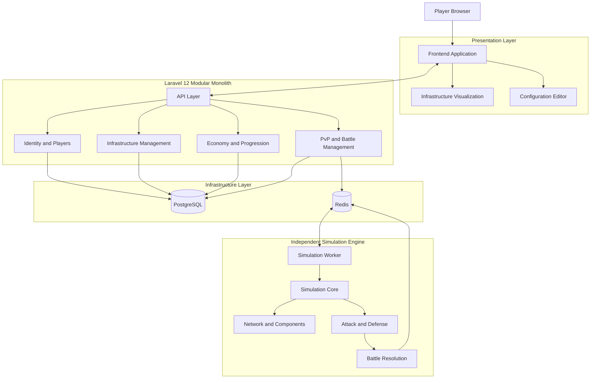

# CYBERFRONT

## System Architecture Overview

**Document ID:** CF-ARCH-001  
**Architecture Decision:** CF-ADR-001  
**Version:** 1.0.0  
**Phase:** 0 - Product Foundation  
**Task:** 02.1 - System Architecture Overview  
**Status:** Approved  
**Date:** November 25, 2026

---

# 1. Introduction

## 1.1 Purpose

Dokumen ini mendefinisikan gambaran arsitektur sistem CYBERFRONT sebagai fondasi teknis untuk pengembangan aplikasi.

Dokumen mencakup:

- Overall system architecture.
- Architectural style.
- System layers.
- Component responsibilities.
- Communication principles.
- Data ownership.
- Simulation execution.
- Repository structure.
- Scalability considerations.

Dokumen ini menjadi referensi bagi seluruh implementasi teknis berikutnya.

## 1.2 Architectural Decision

CYBERFRONT menggunakan:

**Modular Monolith + Independent Simulation Engine**

Arsitektur ini menggabungkan backend modular berbasis Laravel dengan Simulation Engine independen berbasis TypeScript.

Laravel bertanggung jawab atas application business logic, sedangkan Simulation Engine bertanggung jawab atas seluruh perilaku dan mekanisme simulasi teknologi.

## 1.3 Design Goals

Arsitektur harus memenuhi kebutuhan berikut:

1. Modular application structure.
2. Independent simulation execution.
3. Deterministic simulation.
4. Clear service boundaries.
5. Reliable asynchronous processing.
6. Data consistency.
7. Horizontal scalability where necessary.
8. Future real-time multiplayer support.
9. Maintainability and testability.
10. Technology independence between application and simulation layers.

---

# 2. Architectural Style

## 2.1 Modular Monolith

Backend utama menggunakan Laravel 12 dengan pendekatan Modular Monolith.

Seluruh application modules berjalan dalam satu aplikasi backend, tetapi memiliki batas tanggung jawab dan domain yang jelas.

Keuntungan:

- Simplified deployment.
- Centralized application management.
- Lower operational complexity.
- Easier development and debugging.
- Clear domain separation.
- Easier integration between modules.

Modular Monolith tidak berarti seluruh kode boleh saling mengakses tanpa aturan.

Setiap modul harus memiliki tanggung jawab, interface, dan batas dependensi yang jelas.

## 2.2 Independent Simulation Engine

Simulation Engine dibangun menggunakan TypeScript sebagai proyek dan proses independen.

Engine tidak bergantung pada Laravel, Eloquent ORM, maupun implementasi internal backend.

Tanggung jawab engine meliputi:

- Infrastructure simulation.
- Component behavior.
- Network behavior.
- Attack execution.
- Defense evaluation.
- Resource modeling.
- Event processing.
- Battle resolution.
- Simulation replay.

Engine menerima input melalui kontrak yang telah ditentukan dan menghasilkan output simulasi yang dapat divalidasi backend.

## 2.3 Architecture Diagram



The diagram represents logical architecture. Actual deployment topology may evolve independently.

---

# 3. System Layers

## 3.1 Presentation Layer

**Technology:**

- TypeScript
- Alpine.js
- Cytoscape.js
- Monaco Editor

Responsibilities:

- User interface.
- Isometric infrastructure workspace.
- Component placement.
- Infrastructure visualization.
- Configuration management.
- Resource monitoring.
- Battle interface.
- Battle report and replay visualization.

The frontend must not independently calculate authoritative battle outcomes.

## 3.2 Application Layer

**Technology: Laravel 12**

The Application Layer manages the business operations of CYBERFRONT.

Initial modules:

| Module         | Responsibility                    |
| -------------- | --------------------------------- |
| Identity       | Authentication and authorization  |
| Players        | Player profiles and accounts      |
| Infrastructure | Infrastructure management         |
| Components     | Component catalog and ownership   |
| Economy        | Credits and economic transactions |
| Progression    | Technology progression            |
| PvP            | Target selection and matchmaking  |
| Battles        | Battle lifecycle and reports      |
| Administration | Administrative operations         |

Detailed module boundaries will be specified in CF-ARCH-002.

## 3.3 Simulation Layer

**Technology: Independent TypeScript Application**

Responsibilities:

- Simulation initialization.
- Runtime state management.
- Infrastructure topology evaluation.
- Network behavior.
- Component execution.
- Resource consumption.
- Attack execution.
- Defense evaluation.
- Failure propagation.
- Event generation.
- Battle resolution.
- Replay data generation.

The engine must be executable independently of Laravel.

## 3.4 Data Layer

### PostgreSQL

Primary persistent database.

Stores:

- User accounts.
- Player profiles.
- Infrastructure definitions.
- Component configurations.
- Infrastructure snapshots.
- Economy transactions.
- Progression data.
- Battle records.
- Battle reports.
- Simulation metadata.

### Redis

Supporting infrastructure for:

- Job queues.
- Cache.
- Temporary coordination state.
- Event distribution.
- Future real-time communication support.

Redis must not replace PostgreSQL as the authoritative persistent data source.

---

# 4. Architectural Boundaries

## 4.1 Backend Ownership

Laravel owns:

- User identity.
- Player state.
- Inventory.
- Economic state.
- Infrastructure persistence.
- Defense Snapshot persistence.
- Matchmaking.
- Battle lifecycle.
- Battle report persistence.

## 4.2 Simulation Ownership

Simulation Engine owns:

- Runtime simulation state.
- Component execution.
- Network behavior.
- Resource calculations.
- Attack and defense mechanics.
- Simulation events.
- Battle outcomes.

The engine produces simulation results but does not directly modify player accounts, credits, or inventory.

Laravel validates and applies the resulting business transactions.

## 4.3 Frontend Restrictions

Frontend must not be treated as an authoritative source for:

- Credits.
- Inventory.
- Battle outcomes.
- Attack success.
- Defense success.
- Infrastructure validity.

All authoritative decisions must be validated by backend or Simulation Engine according to their responsibilities.

---

# 5. Communication Architecture

## 5.1 Frontend to Backend

Frontend communicates with Laravel through explicit application interfaces.

Initial communication:

- HTTP API.
- JSON request and response.
- Authentication middleware.
- Request validation.

WebSocket communication will be introduced when required by future real-time features.

## 5.2 Backend to Simulation Engine

Laravel communicates with Simulation Engine through an explicit versioned contract.

The communication mechanism must support:

- Job submission.
- Job identification.
- Simulation input.
- Random seed.
- Ruleset version.
- Job status.
- Simulation result.
- Error reporting.

The engine must not depend on Laravel-specific serialized job formats.

The exact transport mechanism will be decided in Task 02.7.

## 5.3 Simulation Result Delivery

Simulation Engine returns:

- Battle identifier.
- Simulation status.
- Result summary.
- Generated events.
- Resource impact.
- Component impact.
- Replay information.
- Ruleset version.

Laravel validates and persists the results.

---

# 6. Asynchronous Battle Processing

The initial PvP mode uses asynchronous battle execution.

Workflow:

1. Attacker requests a battle.
2. Laravel validates attacker eligibility.
3. Laravel retrieves an immutable Defense Snapshot.
4. Laravel constructs a simulation job.
5. Job is submitted to the Simulation Engine.
6. Engine initializes simulation state.
7. Engine executes the attack scenario.
8. Engine evaluates defense behavior.
9. Engine resolves the battle.
10. Engine returns simulation results.
11. Laravel validates and persists the result.
12. Battle Report becomes available to the players.

Battle execution must be independent of the original HTTP request lifecycle.

## 6.1 Snapshot Integrity

Defense Snapshot must be immutable after publication.

Changes to active infrastructure must not modify previously published snapshots.

Each battle must reference the exact snapshot version used during execution.

## 6.2 Reliability

The processing architecture must account for:

- Duplicate job delivery.
- Worker interruption.
- Simulation timeout.
- Invalid simulation input.
- Failed result delivery.
- Retry handling.
- Idempotent result persistence.

Detailed implementation will be defined in subsequent architecture documents.

---

# 7. Simulation Independence

Simulation Engine must remain independent of application framework implementation.

Requirements:

1. No Laravel dependencies inside the engine.
2. No Eloquent dependencies.
3. No direct dependency on Laravel internal queue serialization.
4. Explicit input and output contracts.
5. Independent automated testing.
6. Deterministic execution.
7. Versioned simulation rules.
8. Reusable execution interface for multiple game modes.

The same simulation rules must support asynchronous and future real-time PvP.

---

# 8. Initial Repository Structure

The proposed repository structure:

```text
cyberfront/
│
├── app/
│   ├── Modules/
│   │   ├── Identity/
│   │   ├── Players/
│   │   ├── Infrastructure/
│   │   ├── Components/
│   │   ├── Economy/
│   │   ├── Progression/
│   │   ├── PvP/
│   │   └── Battles/
│   │
│   └── Shared/
│
├── simulation/
│   ├── src/
│   │   ├── core/
│   │   ├── infrastructure/
│   │   ├── networking/
│   │   ├── components/
│   │   ├── attacks/
│   │   ├── defenses/
│   │   ├── resources/
│   │   ├── events/
│   │   └── battle/
│   │
│   └── tests/
│
├── resources/
│   ├── views/
│   ├── css/
│   └── js/
│
├── routes/
├── database/
├── tests/
│
├── docs/
│   ├── product/
│   └── architecture/
│
├── composer.json
├── package.json
└── README.md
```

This is a proposed logical structure. Physical implementation and module organization will be finalized in subsequent tasks.

---

# 9. Scalability Strategy

CYBERFRONT will initially use a relatively simple deployment architecture.

Scaling will be introduced based on measured workload.

## 9.1 Application Scaling

Laravel application instances may be scaled horizontally when required.

## 9.2 Simulation Scaling

Simulation workers can be scaled independently based on pending simulation jobs and resource utilization.

## 9.3 Database Scaling

PostgreSQL remains the primary database.

Database optimization, indexing, connection management, and read scaling will be introduced according to actual workload.

## 9.4 Future Real-Time Expansion

Future Real-Time PvP may introduce:

- Dedicated WebSocket Gateway.
- Real-time session management.
- Session coordination.
- Live event broadcasting.
- Simulation session scheduling.

These additions must reuse the same underlying simulation rules.

---

# 10. Architecture Constraints

The following constraints are mandatory:

| ID       | Constraint                                                      |
| -------- | --------------------------------------------------------------- |
| ARCH-001 | Laravel is the primary application backend                      |
| ARCH-002 | Simulation Engine is independent of Laravel                     |
| ARCH-003 | Simulation Engine uses TypeScript                               |
| ARCH-004 | PostgreSQL is the primary persistent database                   |
| ARCH-005 | Redis is supporting infrastructure                              |
| ARCH-006 | Backend and engine communicate through explicit contracts       |
| ARCH-007 | Frontend cannot determine authoritative battle outcomes         |
| ARCH-008 | Defense Snapshots are immutable                                 |
| ARCH-009 | Simulation supports deterministic execution                     |
| ARCH-010 | Asynchronous and real-time modes share simulation rules         |
| ARCH-011 | Business transactions are controlled by Laravel                 |
| ARCH-012 | Simulation execution is isolated from production infrastructure |

---

# 11. Technology Stack

| Layer                | Technology                    |
| -------------------- | ----------------------------- |
| Backend              | Laravel 12                    |
| Frontend             | TypeScript                    |
| UI Interaction       | Alpine.js                     |
| Database             | PostgreSQL                    |
| Cache                | Redis                         |
| Queue Infrastructure | Redis                         |
| Visualization        | Cytoscape.js                  |
| Code Editor          | Monaco Editor                 |
| Simulation           | Independent TypeScript Engine |
| Real-Time            | WebSocket                     |

Technology choices may be refined through dedicated architecture decisions.

---

# 12. Architecture Decision Record

**Decision ID:** CF-ADR-001

**Title:** Modular Monolith + Independent Simulation Engine

**Status:** Accepted

## Context

CYBERFRONT requires a backend capable of handling application business logic and a simulation system capable of processing complex infrastructure behavior.

Using a single tightly coupled backend would limit the independence of the Simulation Engine.

Using full microservices architecture from the beginning would introduce unnecessary operational complexity.

## Decision

Use Laravel Modular Monolith for application responsibilities and an independent TypeScript Simulation Engine for simulation responsibilities.

## Consequences

Positive:

- Clear separation of concerns.
- Independent simulation development.
- Easier initial deployment.
- Lower infrastructure complexity.
- Future independent scaling.
- Shared simulation foundation across game modes.

Trade-offs:

- Cross-process communication must be designed.
- Input and output contracts must be maintained.
- Result consistency requires careful handling.
- Monitoring must cover both application and simulation processes.

## Future Review

Reconsider service decomposition when actual workload, operational complexity, or team ownership justifies it.

---

# 13. Acceptance Criteria

Task 02.1 is considered complete when:

- [ ] Architectural style is documented.
- [ ] Overall system diagram is available.
- [ ] System layers are defined.
- [ ] Backend responsibilities are established.
- [ ] Simulation responsibilities are established.
- [ ] Data ownership is documented.
- [ ] Communication principles are defined.
- [ ] Asynchronous processing workflow is documented.
- [ ] Repository structure is proposed.
- [ ] Scalability strategy is established.
- [ ] Architecture constraints are documented.
- [ ] ADR-001 is recorded.

---

# 14. Related Documents

| Document ID | Document                       |
| ----------- | ------------------------------ |
| CF-PROD-001 | Product Foundation             |
| CF-ARCH-001 | System Architecture Overview   |
| CF-ARCH-002 | Service Boundaries             |
| CF-ARCH-003 | Frontend Architecture          |
| CF-ARCH-004 | Backend Architecture           |
| CF-ARCH-005 | Simulation Engine Architecture |
| CF-ARCH-006 | Database Architecture          |
| CF-ARCH-007 | Communication Architecture     |
| CF-ARCH-008 | Battle Processing              |

---

**Document Status:** Approved  
**Document Version:** 1.0.0  
**Next Task:** Phase 0 - Task 02.2: Service Boundaries

**CYBERFRONT**

Build systems like an engineer.  
Attack like an adversary.  
Defend like an operator.

---

End of Document.
